<p align="center"><picture>
<source media="(prefers-color-scheme: dark)" srcset="assets/drumtonic/stack-su-scuro.svg">
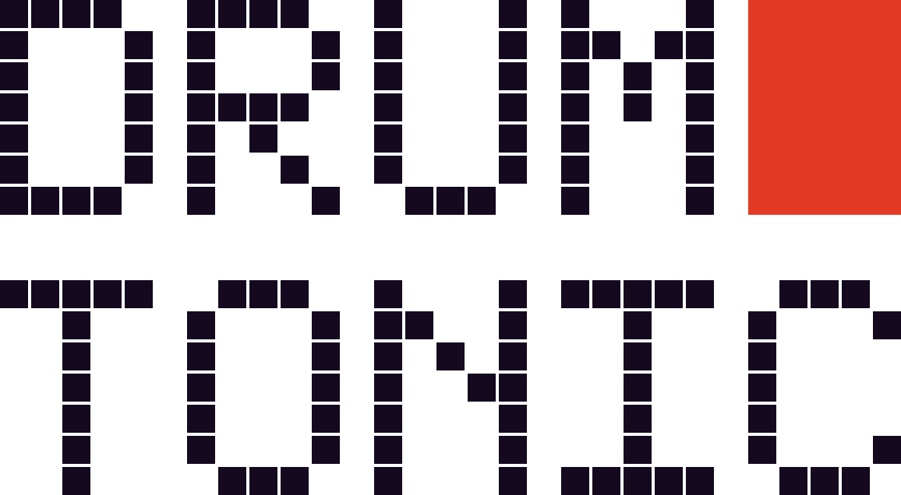
</picture></p>

# Drumtonic

**Turn the M-Vave FM-1 into a drum machine.** Ten synthesized drum channels, a 64-step sequencer with p-locks,
conditions, micro timing and ratchets, beat repeat, a reverb, a tape delay and a master compressor. It all runs
on the instrument itself, with no computer and no samples, and plays through its own output.

<p align="center">
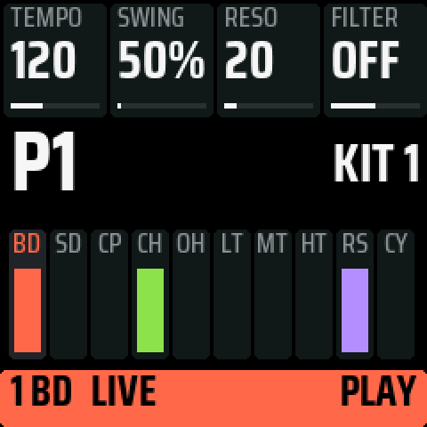
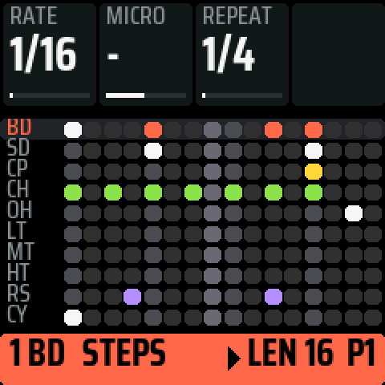
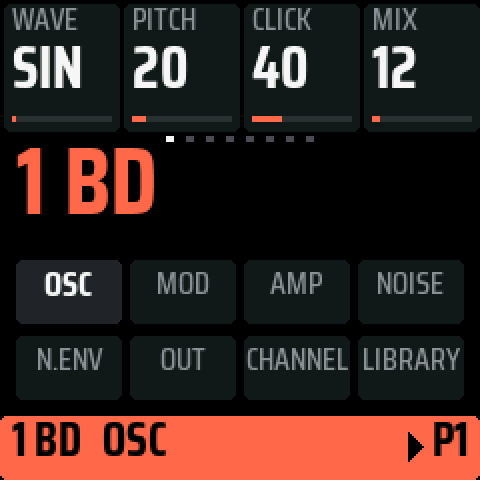
</p>

**Install it in under a minute from your browser**: open the
[Drumtonic installer](https://fc79.github.io/drumtonic/) in Chrome or Edge, plug in the FM-1 and press two
buttons. [More below](#install).

## What it does

### Sound: ten channels, synthesized

- **10 channels**: BD SD CP CH OH LT MT HT RS CY. Each one is an oscillator (sine, triangle or saw, with a pitch
  envelope, an LFO or random modulation) plus a filtered noise (low, band or high pass, with exponential, linear or
  clap envelopes, mono or stereo).
- **24 controls a channel**, in eight banks: the oscillator, its modulation, the amp, the noise and its envelope,
  distortion, EQ, level, pan, choke groups, click. The full list is in [docs/DRUMS.md](docs/DRUMS.md).
- **Three factory kits**: CLASSIC, TIGHT and INDUSTR. There are 8 places for your own kits.
- **A sound library**: 59 ready sounds and 64 places for yours. Scroll the list and the channel plays each sound
  in the running pattern as you go.

<p align="center">
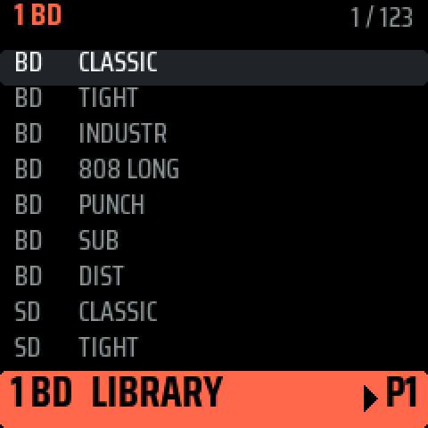
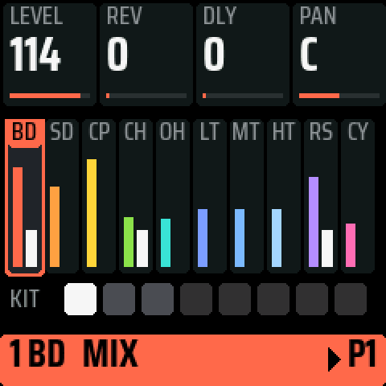
</p>

### Sequencer: 32 patterns, up to 64 steps

- **32 patterns** of 10 parts. Each part has its own length, from 1 to 64 steps, so you can loop a 3-step hat
  against a 16-step kick.
- **Rate and swing**: 1/16, 1/16T, 1/32 or 1/8T, and swing from 50 to 75 %.
- **Hold a step and turn a knob**. That step gets a **p-lock** of that sound value, a **condition** (a chance from
  5 to 95 %, FILL, NOT FILL, or a cycle from 1:2 to 8:8), **micro timing** (up to 23/24 of a step early or late)
  or a **ratchet** (2, 3 or 4 hits in the step).
- **Knob motion**: press REC and turn a knob while it plays. The movement is recorded and plays back on every loop.
- **8 LFOs per pattern**: hold LFO and turn any knob. Each LFO is synced to the bars (1/32 to 16 bars) or free
  (0.05 to 20 Hz), with a triangle, saw, square or sample & hold shape.
- **Live recording**: hits you play on the keys land on the nearest step.
- **Chains**: hold a pattern key and tap others to play them in that order. The next pattern always starts at the
  end of the bar.
- **Each pattern has its own kit**, effects included, and it loads as the pattern starts.
- **Mute, solo, FILL, copy, paste, clear**, and **undo and redo** of the last change.

<p align="center">
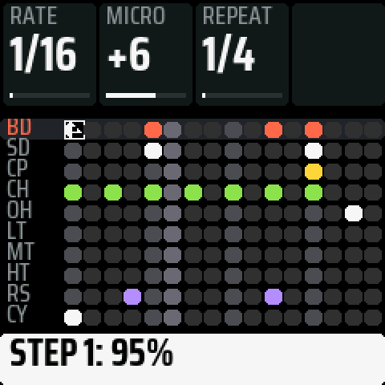
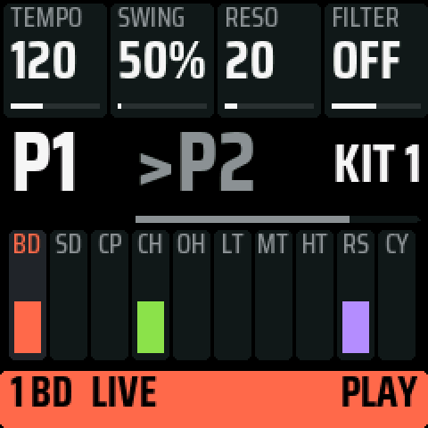
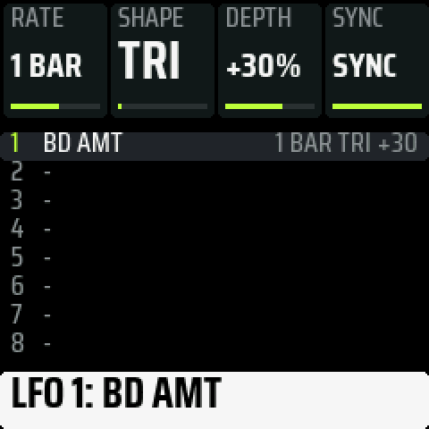
</p>

### Performance

- **Beat repeat**: tap ARP on LIVE, then hold white key 1-4 and the last 1/4, 1/8, 1/16 or 1/32 loops. Let go
  and the pattern is right where it would have been.
- **Note repeat**: tap ARP on STEPS, then hold a channel's key and it repeats at 1/4 to 1/32, triplets included. With REC on, the
  repeats are recorded, and several hits on one step become a ratchet.
- **Kits on the keys**: on MIX, a tap on a white key loads one of the 8 kits.

### Effects and master

- **Reverb** and **delay** that every channel sends to. The delay time is a note value, and its TAPE control
  goes from clean to wow, flutter and saturation. It can also run ping-pong.
- **Master**: drive, a 24 dB/octave low- and high-pass filter with resonance, and a **compressor**. The compressor
  has threshold, ratio, attack and release in ms, a sidechain high-pass so the kick drives it less, and dry/wet
  for parallel compression. A transparent look-ahead limiter sits at the end.

<p align="center">
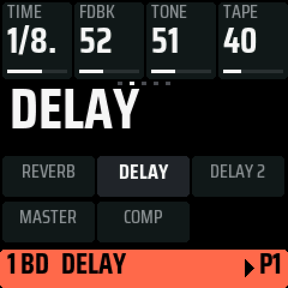
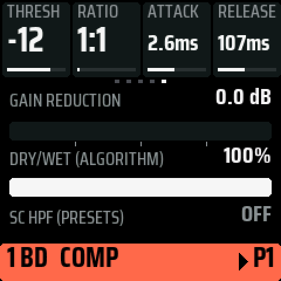
</p>

### On the panel

- **The screen is made to be read from a distance.** The 4 knobs are along the top, level with the real ones. The
  page is in the middle, and a band along the bottom has the channel's colour (red while recording). A knob you turn
  shows its value large.
- **Hold any button** for a quarter of a second to see what it does on that page.
- **The knobs accelerate**: turn slowly for single steps, quickly to sweep the whole range.
- **The keys light up** with what is playing: each channel's key flashes on its hits, and the white keys follow
  the playhead.

<p align="center">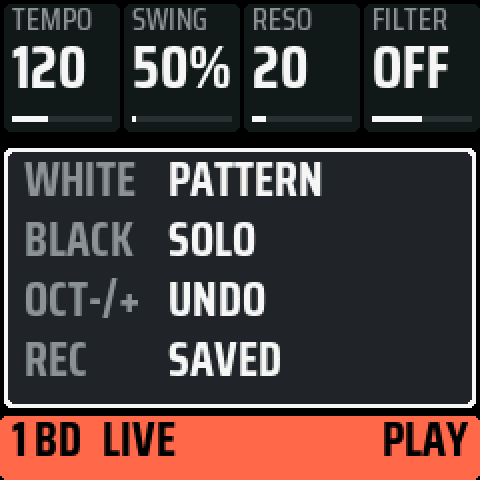</p>

### Connections

- **MIDI over USB**: notes 36-45 in (any channel) and out (channel 10), and MIDI clock, start and stop out. Notes
  also come in on the TRS MIDI jack.
- **USB audio**: the computer sees the FM-1 as an audio input and records exactly what it plays.
- **Two cores at 320 MHz**: the sound engine uses both of the chip's cores.

## Install

**Back up the flash first.** It writes nothing to the FM-1 and keeps what is unique to your unit:
[docs/BACKUP.md](docs/BACKUP.md). Installing any firmware is at your own risk.

**From the browser** (the easy way). Open the [Drumtonic installer](https://fc79.github.io/drumtonic/) in Chrome
or Edge on a computer (Safari and Firefox have no Web MIDI). Each [release](https://github.com/fc79/drumtonic/releases)
also has it as a single file, `drumtonic-X.Y-installer.html`, which works when opened from disk, even offline. Connect the FM-1 over USB and press **Connect
FM-1**: the page shows what the FM-1 is running now. Then press **Install Drumtonic**. Close any other app that
uses the FM-1's MIDI port first. The page runs the same checks as the command-line installer. It refuses a
package that is not for the instrument connected. The write takes under a minute, and nothing needs to be
installed on the computer.

**From the command line.** You need Python 3 and `pip3 install mido python-rtmidi`. Take the package
`drumtonic-X.Y.fwsc` from [Releases](https://github.com/fc79/drumtonic/releases), or [build it](#build):

```sh
python3 tools/fm1_install.py --info                            # what the FM-1 runs now
python3 tools/fm1_install.py drumtonic-0.1.fwsc --yes          # the install
```

The FM-1 then reports itself as `FM-1_923`, and the start-up screen shows the version.

**What the first save replaces.** Drumtonic keeps its settings, kits and patterns in the places the FM-1
firmwares share (0xFC000, 0xF4000-0xF9FFF), so what another firmware kept there is overwritten. Your backup has
it. The installers never write the boot area (0x0-0x3FFF), 0xC0000-0xC1FFF or the unit's key (0xFF000-0xFFFFF).

The whole manual (every page, button and gesture): **[docs/DRUMTONIC.md](docs/DRUMTONIC.md)**.

## Build

Linux on x86-64, or macOS or Windows with Docker (Podman works as `docker`). You need Python 3 with Pillow,
JieLi's toolchain and three files of the JieLi AC79 SDK:

```sh
tools/get_toolchain.sh                      # JieLi's clang for the chip, to ~/.jieli/toolchain
git clone --depth 1 --branch AC79NN_SDK_V1.2.1_2023-12-13 \
    https://gitee.com/Jieli-Tech/fw-AC79_AIoT_SDK.git ~/fw-AC79_AIoT_SDK
./build.sh                                  # -> build/drumtonic.fwsc
./build.sh --board fm1 --release 0.1        # -> build/drumtonic-0.1.fwsc, "0.1" on the screen
python3 tools/make_installer.py build/drumtonic-0.1.fwsc -o drumtonic-0.1-installer.html
```

The last line writes the browser installer as a single HTML file with the package inside. It works when opened
from disk, so you can also share it as a file.

Without the instrument, the firmware also runs on a computer:

```sh
tests/run_host.sh tests/scripts/drumtonic_fm1_tour.txt    # every page: screens as PNG, the sound as WAV (build/host/)
tools/docs_screens.sh 0.1                                  # the screenshots on this page
./build.sh && sh tests/run_tests.sh                        # the whole test suite
```

Where things are: `firmware/src/drumtonic.c` is the entry point. `app_fm1.c` and `ui_fm1.c` are the app, and
`drum.c` is the sound engine. The chip's rules are in [docs/RULES.md](docs/RULES.md), and the platform's own
documentation is in [docs/dinghy/](docs/dinghy/DINGHY.md).

## License and credits

GPL-3.0-only: you may change and share Drumtonic. Whoever gets a firmware built from it gets its source too. If you
pass the installer on, say where the source is.

Drumtonic (the app, the panel, the drum engine, the sequencer, the kits) is by fc79, 2026. It is built on
[Dinghy](docs/dinghy/DINGHY.md) by zvenson, which is built on Felucca's platform: Copyright (C) 2026 Leo
Kuroshita (@kurogedelic), Hügelton Instruments, with SLOOP's changes (isod89). The design of its interface follows
X0X by Charles Vestal, and its effects follow 9W9's. Who made what: [LICENSING.md](LICENSING.md).

"M-VAVE" and "FM-1" belong to their owners. Drumtonic is not made or endorsed by them.
