# Drumtonic: the manual

Drumtonic turns the M-Vave FM-1 into a drum machine with 10 synthesized channels (BD SD CP CH OH LT MT HT RS CY),
32 patterns of up to 64 steps, 8 kits, a reverb, a delay and a master. The sound engine is described in
[DRUMS.md](DRUMS.md).

## The screen

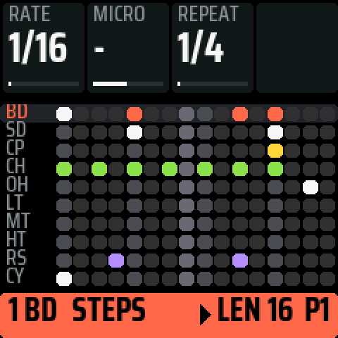
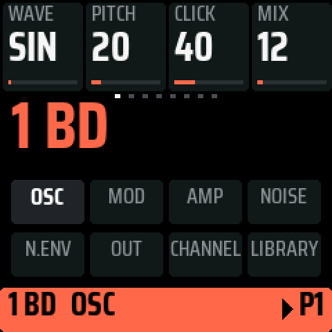

The screen has three bands:

- **Top**: the 4 knobs, level with the real ones. The dots under them show the banks of the page.
- **Middle**: the page.
- **Bottom**: the state. It shows the channel, the page, the part's length and the pattern. It takes the channel's
  colour, turns red while recording and white for a message.

Turning a knob shows its name and value large over the page for a second. A gesture such as a paste or a save
ends in a large two-word message (`PASTE` / `P5`, `SAVED` / `KIT 3`). When something cannot be done, its first
word is grey (`NOTHING` / `TO PASTE`).

## How it works

1. **A button, a page.** A button opens its page; pressed again, it opens the page's next bank. The open page's
   button is lit, and the others that open something glow.
2. **The knobs accelerate.** Turned slowly they move one step a click. Turned faster they move 2, 4 and up to 8
   steps a click, so a quick turn crosses 0-127 in about one turn. TEMPO, SWING, RATE, MICRO, switches and short
   ranges always move one step.
3. **The black keys 1-10 are the channels.** On LIVE they mute; on every other page they pick the channel. They
   light the same way everywhere: bright when the channel plays, dim when silent, dark when muted. The chosen
   channel blinks while stopped. While playing, it stays lit and dips on each hit; the white keys show the playhead
   the same way. Black key 11 held with white keys sets the channel's accents.
4. **The three encoders on the left** work on every page. SELECT picks the channel (1-10, then ALL). On SEQ,
   PRESETS sets the part's length and ALGORITHM shifts its steps. In a list, SELECT picks the row and ALGORITHM sets
   the value.
5. **Hold a step and turn.** On SOUND, a knob locks that step's value (a p-lock). ALGORITHM sets its condition.
6. **Hold a button to see what it does.** Any button held alone for a quarter of a second (except SEL, PLAY and REC)
   shows a guide over the page, one gesture per row; letting it go then does nothing else.

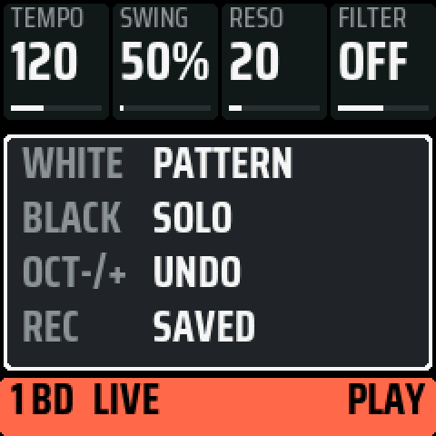

## The pages

### HOME: LIVE and SETTINGS

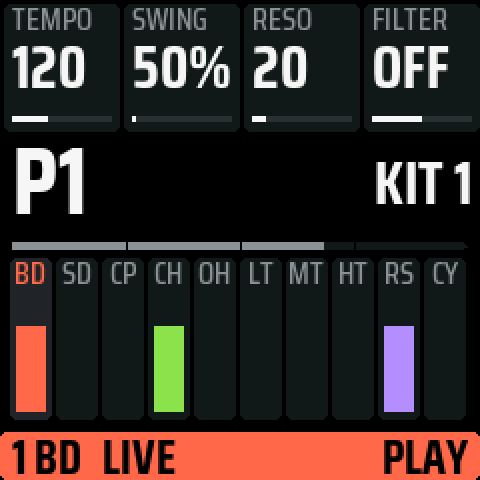
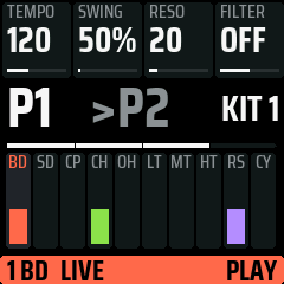

**LIVE** is the page to play from.

- **Patterns.** The white keys pick the pattern (OCT- and OCT+ switch between 1-16 and 17-32). While playing,
  the next pattern starts at the end of the bar: `>P2` waits at the top, grey, with a bar filling up to the
  change.
- **Chains.** Hold a pattern key and tap others: a chain, played in that order.
- **Mute.** The black keys mute the channels (LIVE is the only page where they do).
- **Knobs**: TEMPO, SWING, and the master filter's RESO and FILTER.
- **The kit.** The pattern's kit is shown at the top right, large enough to read standing up. `KIT 3*` means it
  has edits not yet saved, and `>KIT 1` shows the next pattern's kit.
- **Beat repeat.** A tap on ARP turns it on (ARP lit, `REPEAT` in the bottom band) and another turns it off. While
  it is on, holding white key 1-4 repeats the last 1/4, 1/8, 1/16 or 1/32: the slice plays once as it is, then again
  and again while the key is held. Another of those keys while it loops changes the length, taking a piece of the
  loop you hear. If the slice had no hit yet, it repeats the slice of the last hit, so it never repeats silence.
  Let go, and the pattern is where it would have been. Beat repeat changes nothing in the pattern, and leaving
  HOME or stopping ends it. HOME + a white key still picks a pattern.

HOME again opens **SETTINGS**: CLOCK, REC, CLEAR PATTERN, FACTORY KITS, CPU (the load), VERSION, POWER. SELECT picks a
row, SEL runs it. REC is GRID or FREE: how hits are recorded (see Playing by hand).

### SEQ: STEPS

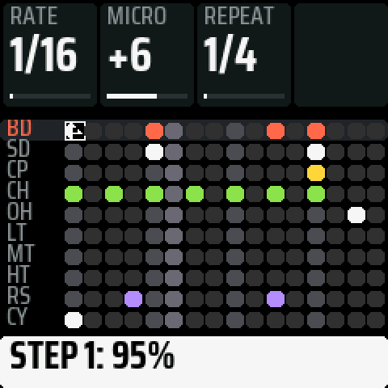

The 10 channels by 16 steps; OCT- and OCT+ show steps 17-64. The white keys are the chosen channel's steps.
A tap turns a step on or off. An empty step turns on as you press it, so you can press, hold and turn in one go.

- **Knobs**: RATE (1/16, 1/16T, 1/32, 1/8T), MICRO, REPEAT (note repeat's rate) and QUANT.
- **QUANT** pulls the chosen channel's micro timing toward the grid as it plays (with ALL selected, every
  channel's): 0 % plays it as recorded, 100 % on the grid. The steps keep their timing, so turning back gives it
  back; the cells show what you hear, and MICRO with a step held shows the timing as recorded. GLO + QUANT puts it
  back to 0 %. SAVE writes it into the steps and puts QUANT back to 0 %.
- **Part length.** PRESETS sets the chosen part's length: 1, 2, 3, 4, 5, 6, 8, 12, 16, 24, 32 or 64 steps (with
  ALL selected, every part's). A longer length copies the steps, and going back gives the original. Parts of
  different lengths loop on their own, and the next pattern starts at the end of the longest part.
- **Shift.** ALGORITHM moves the channel's steps one step a click (with ALL selected, every channel's).
- **Condition.** Hold a step and turn ALGORITHM: clockwise 95 % to 5 %, anticlockwise FILL, NOT FILL, then the
  cycles 1:2 to 8:8; 100 % in the middle.
- **Micro timing.** Hold a step and turn MICRO (or press OCT+ / OCT-): 1/24 of a step later or earlier per click,
  up to 23/24 either way. The knob pauses at 0 before crossing to the other side. GLO + MICRO puts the step back
  on the grid. The step's cell moves that way on the screen.
- **Ratchet.** Hold a step and press ARP: 1, 2, 3, 4 hits in the step, then 1 again. The cell shows a dot. A
  ratchet always plays to its last hit.
- **Note repeat.** A tap on ARP turns it on (`RPT 1/4` in the bottom band) and another turns it off; leaving SEQ
  turns it off too. While it is on, a black key repeats its channel while held: a hit at once, then evenly at the
  rate. The rates are 1/4, 1/4T, 1/8, 1/8T, 1/16, 1/16T, 1/32 and 1/32T, set with REPEAT or ARP held + white keys
  1-8. With REC on, each hit is recorded on the nearest step, one hit a step (with REC on FREE, with its micro
  timing).

A lock, a condition, micro timing and a ratchet are all copied, pasted, cleared, undone and saved with the step.

### EDIT: SOUND and LIBRARY

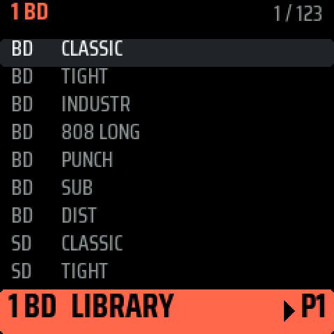

**SOUND** is the chosen channel's sound in eight banks: OSC, MOD, AMP, NOISE, N.ENV, OUT, CHANNEL (level, pan,
the reverb and delay sends) and LIBRARY. EDIT again or OCT+ opens the next bank, and OCT- the one before. The white
keys are the steps here too, for p-locks: hold a step and turn a knob.

**LIBRARY** lists 59 factory sounds (the kits' and 33 more: kicks, snares, hats, toms, congas, cowbell, clave,
shaker, cymbals, effects) and 64 places for yours. SELECT moves through the rows (ALGORITHM 8 at a time), and the
channel plays each one at once, in the running pattern. SEL loads it with its name. GLO + SEL saves the channel's
sound (on a factory row, into the first free place). GLO + REC deletes one of your sounds.

On SOUND, GLO held copies the channel's sound and GLO + a black key pastes it onto another channel, with its
name and sends.

### ENV: MIX and the kits

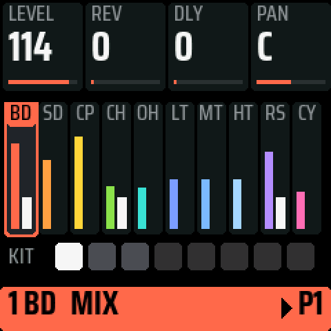

Every channel's level and meter. The black keys pick the channel, and the knobs are its LEVEL, REV and DLY (the
sends) and PAN.

White keys 1-8 are the **kits**. A tap loads one, and a tap on the kit already playing takes it back to its saved
version. GLO + a white key saves the kit there.

**Each pattern has its kit.** A pattern takes the kit playing when it gets its first step, a kit loaded here
becomes the playing pattern's kit, and a pasted pattern brings its own. A pattern that starts with another kit
loads it, effects included, just before its first hit (in a chain too). The edits of a kit are kept while another
plays; SAVE stores every kit, and its LED blinks while any kit has edits not saved.

### LFO

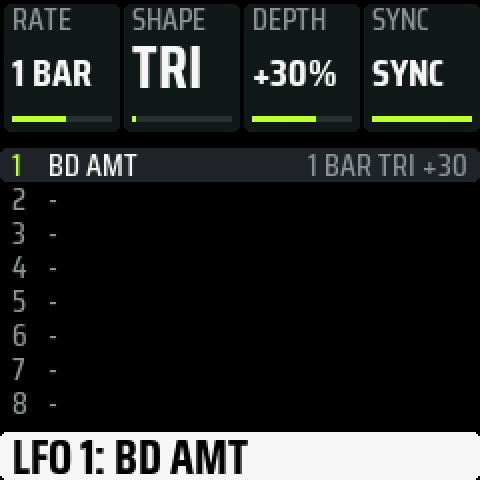

The pattern's 8 LFOs. To put one on a knob, hold LFO and turn that knob. SELECT picks an LFO; the knobs are RATE
(1/32 to 16 bars when synced, 0.05 to 20 Hz when free), SHAPE (triangle, saw, square, sample & hold), DEPTH
(-100 to +100 %) and SYNC.

### FX: REVERB, DELAY, DELAY 2, MASTER, COMP

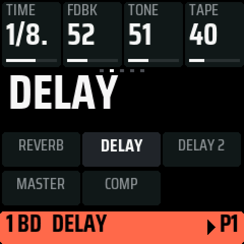
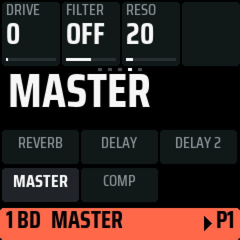
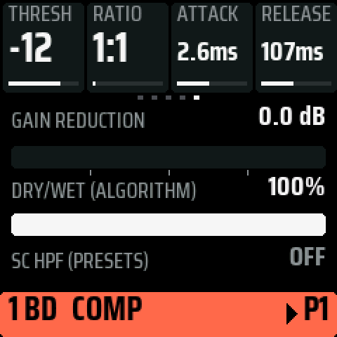

FX again or OCT+ opens the next bank, OCT- the one before. The sends are on MIX and on SOUND's CHANNEL bank.

- **REVERB**: decay, tone, low cut. It returns at unity gain; each channel's REV send sets how much it gets.
- **DELAY**: time as a note value, feedback, tone and TAPE (0 is a clean digital delay; turned up, it adds wow,
  flutter and saturation).
- **DELAY 2**: low cut and ping-pong. Like the reverb, the delay returns at unity gain.
- **MASTER**: DRIVE; FILTER, a 24 dB/octave low-pass below the middle and high-pass above it (shown L1-L64,
  OFF, H1-H63); RESO, from none to a peak of +17 dB.
- **COMP**: THRESH, RATIO (1:1 is off), ATTACK and RELEASE in ms, with a soft knee and automatic make-up. PRESETS
  is the sidechain high-pass (OFF, 60, 90, 150 Hz), so the kick drives it less. ALGORITHM is dry/wet, for parallel
  compression. The page shows the gain reduction.

The master's chain, in order: the channels and the two returns, DRIVE, COMP, FILTER, then a look-ahead limiter
that is always on. It does nothing under -0.2 dBFS and stops every peak at the ceiling.

## Buttons and gestures

| | |
| --- | --- |
| PLAY | play and stop |
| REC | record: hits on white keys 1-10 (except on HOME) and knob moves |
| SAVE | saves everything: the sound, the 8 kits and the 32 patterns, with QUANT written into the steps. It works while playing too; the sound goes on |
| SEL | held: FILL. In a question: yes. In a list: run the row |
| ARP | HOME: beat repeat. SEQ: note repeat. A step held: its ratchet |
| MASTER | the volume |
| GLO held | copy what the page shows: the step held, the channel's part on STEPS, its sound on SOUND, the LFO on LFO, otherwise the pattern |
| GLO + a key | paste there |
| GLO + REC | clear |
| GLO + a knob | remove that knob's motion and LFO |
| HOME + a white key | pick a pattern from any page |
| HOME + a black key | solo the channel |
| HOME + REC | the pattern as last saved |
| HOME + OCT- / OCT+ | undo / redo |

**Knob motion.** With REC on and the pattern playing, turn a sound knob: the movement is recorded on the steps it
passes and plays back gliding from step to step. Turned without REC, the knob takes over for one pass.

**Playing by hand.** On SEQ and EDIT a black key plays its channel while stopped; while playing, only with REC
on, and then the hit is recorded. With REC on, the white keys 1-10 are the channels (except on HOME). The keys
have no velocity: a hit by hand plays at 100, and accents come from the steps. A hit goes on the nearest step;
with SETTINGS > REC on FREE it also keeps how early or late it came, up to half a step, as that step's micro timing
(over what the step had). The same goes for notes over MIDI and for note repeat.

**Undo.** HOME + OCT- goes back to before the last change, and HOME + OCT+ goes forward again. It covers the
patterns, motion, p-locks, conditions, micro timing, QUANT, LFOs, the sounds, the kit's sends and the effects. It does
not cover the tempo, mute, solo, SETTINGS, or what is already saved. A change is one button press, a knob or an
encoder until 1 s without a click, the keys until 2 s without a tap, or one REC pass. Undo is kept in memory
until power-off.

**At power-on** the first pattern plays under a playhead, then the screen shows the name, the version and the
identity until a key or a button is pressed (that press only closes it).

## MIDI and USB

- **In**, over USB and the TRS jack: notes 36-45 on any channel play channels 1-10, and record with REC on.
- **Out**, over USB: every hit the sequencer plays and every channel hit by hand, as notes 36-45 on channel 10,
  plus the clock (24 a quarter), START and STOP.
- **USB audio**: the computer sees the FM-1 as a stereo audio input and records exactly what it plays.

## The processor

Drumtonic runs both of the chip's cores at 320 MHz. In each block of 16 frames, half of the sounding channels and
the reverb are rendered on the second core. The result is the same, bit for bit, as on one core. If the second
core ever fails to answer, the FM-1 goes on with one. SETTINGS > CPU shows the load and what runs.

## What is kept

SAVE writes the sound, its sends and effects, the 8 kits and the 32 patterns with their lanes and LFOs. The
settings (kit, tempo, pattern, channel, clock) are saved with SAVE too, and nothing is written by itself. Your
library sounds are written as soon as you save or delete one.

These are the places the FM-1 firmwares share: the settings at 0xFC000, the kits and patterns at 0xF4000-0xF9FFF,
the library at 0x97000 and 0x9B000. **A save replaces what another FM-1 firmware kept there**, so back up first:
[BACKUP.md](BACKUP.md).

Drumtonic reports itself as `FM-1_987`.

## If it goes wrong

If an install is cut off, power-cycle the FM-1 and run the install again. If Drumtonic fails to start twice, the
FM-1 opens a USB rescue by itself. You can get there yourself by holding **OCT-** while switching on, and
install a working package from it.

## On a computer

`tests/run_host.sh tests/scripts/drumtonic_fm1_tour.txt` runs the firmware on the computer and writes the screens
and the sound to `build/host/`. `tools/docs_screens.sh` makes the screenshots of these pages, and
`tests/run_tests.sh` runs the whole test suite.
